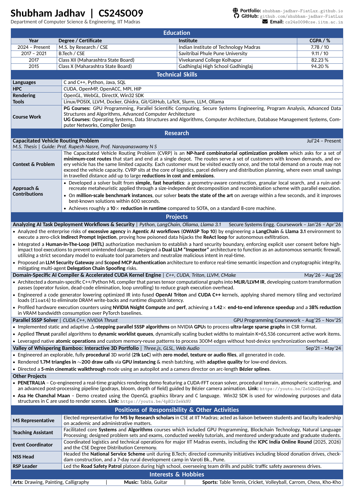
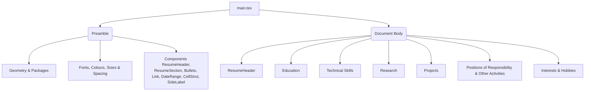

# One-Page LaTeX Resume Template

A dense, table-based one-page LaTeX resume for software engineers, researchers, and other technical profiles. Every section is a bordered box with a coloured title banner, and the content inside is laid out with `tabularx`, so columns and borders stay aligned across the whole page.



## Features
- **High information density**: fits education, skills, coursework, a research section, several projects, and positions of responsibility on one A4 page.
- **Consistent table layout**: built from `tabularx` inside `tcolorbox`. There are no floats, so nothing moves around between compiles.
- **Centralised styling**: fonts, colours, spacing, and widths are defined once in the preamble.
- **Selectable text**: the output is a normal text PDF (`glyphtounicode` is enabled, so ligatures and symbols copy correctly). See [Limitations](#limitations) for notes on ATS parsing.

## Repository Layout

```
.
├── main.tex                   # The resume source (preamble = theme + components, body = content)
├── Resume_ShubhamJadhav.pdf   # Example output
├── assets/preview.png         # Screenshot used in this README
├── LICENSE
└── README.md
```

## Document Structure



## How to Compile

> **Engine: pdfLaTeX only.** The template uses `\pdfgentounicode` and the pdfLaTeX font setup for Carlito, so it will not compile with XeLaTeX or LuaLaTeX as is.

### Overleaf (easiest)
1. Download this repository as a ZIP.
2. In Overleaf, choose **New Project → Upload Project** and select the ZIP.
3. Make sure **Menu → Compiler** is set to **pdfLaTeX**.

### Local
Install a full TeX distribution (TeX Live or MiKTeX). The template uses the `extarticle` class (from the `extsizes` bundle) and these packages: `geometry`, `fontenc`, `xcolor`, `carlito`, `tcolorbox`, `tabularx`, `array`, `enumitem`, `fontawesome5`, `hyperref`.

```bash
pdflatex -jobname=Resume_YourName main.tex
```

`-jobname` sets the output file name (`Resume_YourName.pdf`); without it you get `main.pdf`. The first run in a clean folder may print a `rerunfilecheck` warning about `.out`. Run once more, or use `latexmk -pdf main.tex`, to clear it.

## Customisation

All styling lives in the preamble, under the `THEME` comments.

| What | Where |
| --- | --- |
| Page margins | `\usepackage[left=…,right=…,top=…,bottom=…]{geometry}` |
| Body font | Uncomment one of the ready-made alternatives below the `carlito` line (Lato, Roboto, Fira Sans, Open Sans, Noto Sans) and comment out `carlito`. They are pre-scaled to keep the page to one page; re-check `\SideLabel` offsets afterwards |
| Body font size / line spacing | `\BodyFontSize` → `\fontsize{<size>}{<baselineskip>}` |
| Name, banner, and entry-title sizes | `\NameFont`, `\BannerTitleFont`, `\EntryTitleFont` |
| Accent colour | Uncomment one of the ten preset `PrimaryColor` lines (Navy, Steel Blue, Slate Blue, Teal, Forest Green, Royal Purple, Burgundy, Crimson, Burnt Orange, Charcoal), or set your own RGB. `SecondaryColor` (row shading) is derived from it as `PrimaryColor!20` |
| Text/link greys | `DarkGrey`, `MediumGrey` (`LinkColor`) |
| Gap between bullets | `itemsep=2.5pt` in the `Bullets` environment |
| Padding inside table cells | `\setlength{\extrarowheight}{1.5pt}` |
| Width of the left label column | `\setlength{\LabelWidth}{2.8cm}` |
| Border thickness | `\setlength{\RuleWidth}{0.5pt}` |
| PDF title/author metadata | `pdftitle`, `pdfauthor` in `\hypersetup` |

## Editing Content

### Header
```latex
\ResumeHeader{Your Name}{Tagline or ID}%
{Department / current role}%
{\textbf{\faGlobe \hspace{2pt} Portfolio:} \Link{https://example.com}{example.com}}%
{\textbf{\faGithub \hspace{2pt} GitHub:} \Link{https://github.com/you}{github.com/you}}%
{\textbf{\faEnvelope \hspace{2pt} Email:} \Link{mailto:you@example.com}{you@example.com}}
```
The right-hand contact block is `0.35\linewidth` wide. Keep each line short enough to fit; a long URL will run past the margin.

### A new section
```latex
\begin{ResumeSection}{Section Title}
  \begin{tabularx}{\linewidth}{ X }
    ... rows ...
  \end{tabularx}
\end{ResumeSection}
```

### A label + description row (Skills, Positions, Research)
These sections use a shaded label column: `{ >{\columncolor{SecondaryColor}\bfseries}p{\LabelWidth} | X }`.
```latex
\CellStrut \SideLabel[0.5\baselineskip]{Label} & Description text. \\ \hline
```
Finish every row except the last with `\\ \hline`.

**Centring the label vertically:** `\SideLabel[<offset>]` lowers the label by `<offset>`. The offset is set by hand for each row:

```
offset = (lines in the description − lines in the label) / 2 × \baselineskip
```

For example, a 2-line description with a 1-line label uses `0.5\baselineskip`, and a 4-line description uses `1.5\baselineskip`. For a 1-line description, leave out `\SideLabel`. Recompile after changing a description's length and adjust the offset if needed.

### A project entry
```latex
\rowcolor{SecondaryColor}
\CellStrut{\EntryTitleFont Project Title} \textit{| Tech, Stack} \hfill {\DateRange{Jan'25}{Apr'25}} \\
\vspace{-1.5ex}
\begin{Bullets}
  \item First achievement, with \textbf{key terms} in bold.
  \item Second achievement.
\end{Bullets}
\vspace{-1ex} \\ \hline
```
For the last entry in a section, end with `\vspace{-1ex}` and leave out `\\ \hline`.

## Limitations
- **One page only.** Each section is a single unbreakable box. If your content runs past the page, the whole section moves to page 2 instead of splitting. Trim content, or reduce `\BodyFontSize` or the margins.
- **Tight margins.** The top and bottom margins (0.18in / 0.08in) are smaller than many printers can print. Increase them if you need a printed copy.
- **ATS parsing.** The text is fully selectable, but text extractors read table-heavy layouts column by column, and the Font Awesome icons come out as symbol characters. Most human-reviewed and modern ATS pipelines handle this well. If you are applying through a strict keyword-based ATS, check your PDF with a text-extraction tool first.

## Publishing Your Own Copy
- **Personal information:** check what you publish. Leave out your phone number, home address, and personal email if you don't want them public.
- **Keep the history clean:** the included `.gitignore` excludes LaTeX build files (`.aux`, `.log`, `.out`, …) and the default `main.pdf` output.

## License
Released under the [MIT License](LICENSE). You are free to use, modify, and share this template.
